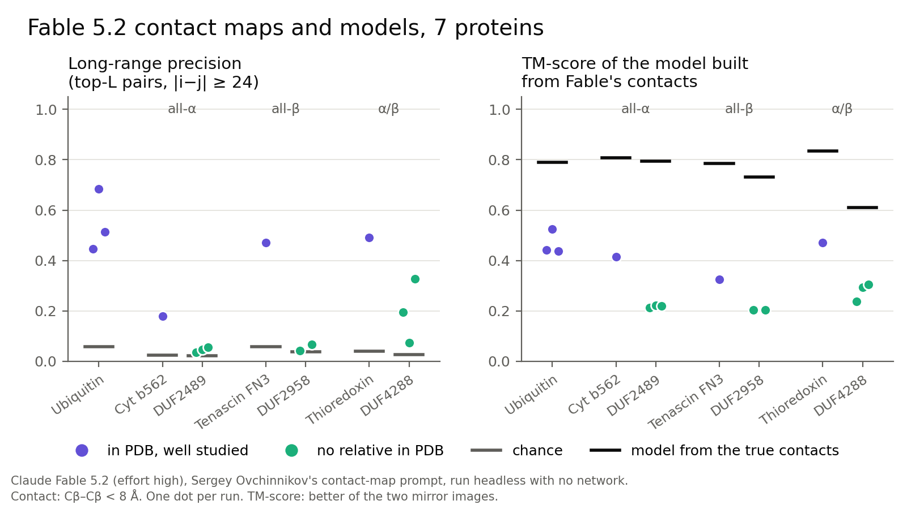

# CheckLLMfold

> **AI-generated.** The code, the analysis and the text in this repository were written by Claude Opus 5.5 in Claude
> Code. All predictions were made by Claude Fable 5.2. A human set the questions and steered the work, but did not
> revise the code and text thoroughly. There may be mistakes.

Two tests of whether Claude Fable 5.2's skill with protein sequences comes from recall of public databases.

1. **Contact maps and 3D models** (this folder). Sergey Ovchinnikov's prompt
   ([shared chat](https://claude.ai/share/068377d7-bace-48bf-8102-c0f144da3887)) on ubiquitin as a control, on three
   well-studied PDB proteins, and on three bacterial proteins with confident AlphaFold DB models and no relative in the
   PDB. Long-range contact precision was 0.18-0.49 on the well-studied proteins and 0.04-0.33 on the proteins with no
   PDB relative, close to chance for two of the three. Asked directly, Fable names the four well-studied proteins down to
   the UniProt and PDB entry, and the Pfam family of two of the three others. A single reply with no tools gives about
   the same contact precision as the full protocol. Details: [results/README.md](results/README.md).
   X thread: https://x.com/jankosinski/status/2122997527192416440
2. **Next amino acid** ([nextaa/](nextaa/)). Xinming Tu and Leo Chen's next-residue probe, on well-known proteins and on
   proteins first public after Fable's training cutoff. Fable 5.2 behaves like a model trained on UniProt: best near
   known sequences, worse far from them, similar to protein language models. Details:
   [nextaa/README.md](nextaa/README.md). X thread: https://x.com/jankosinski/status/2123006759358914813



## Contents (contact test)

- `prompt_template.md`: Sergey Ovchinnikov's prompt with placeholders. Changes: the py2Dmol artifact step is dropped, and
  the final JSON also returns the final contact list.
- `scripts/`: `run_fable.sh` (one headless run), `make_prompt.py`, `foldcode.py` (the `fold()` code from the prompt),
  `evaluate.py` and `aggregate.py` (scoring), `figures.py`, `figures_x.py`, `prep_structures.py` and `model_ss.py`
  (structure images), and the helpers used to select the targets (`rcsb_seqsearch.py`, `foldseek_check.py`,
  `foldseek_tm.py`).
- `runs/jobs/<job id>/`: one folder per Fable run, with the exact prompt (`prompt.md`), the Claude Code stream-json
  output (`transcript.jsonl`), the final answer (`final.txt`), scores (`metrics.json`), the rebuilt model
  (`model_final.pdb`) and the files Fable wrote (`work/`). `runs/jobs.tsv` maps job ids to targets.
- `data/`: reference structures (PDB 1UBQ, 256B, 1TEN, 2TRX; AlphaFold DB models with PAE), target lists, and the target
  selection (`data/candidates/`, with Foldseek results for the three chosen proteins).
- Recognition probe (Fable asked directly what each sequence is, for the contact-test proteins and a sample of the
  next-residue proteins): `scripts/recognize.py`, `scripts/recognition_questions.py`, `scripts/recognition_score.py`,
  questions in `data/recognition/`, replies in `results/recognition/`.
- Single-reply contacts and coordinates without tools: `scripts/oneshot.py`, `scripts/oneshot_score.py`, replies and
  scores in `results/oneshot/`.
- `results/`: `summary.tsv`, figures, the write-up, and the images and text written for an X thread.

Edits to the raw outputs: in each `transcript.jsonl` the first line (session start) is cut down to model, tools and
version, local paths are replaced by `<repo>`, and rate-limit events are removed. Not included: the output of Sergey's
shared chat, a discarded ubiquitin run whose working path contained the protein name, and runs stopped by usage limits.

## Rerunning

Needs the Claude Code CLI with access to `claude-fable-5-2`, Python 3 with numpy, matplotlib for the figures, and
ChimeraX for the structure images. Edit the CLAUDE.md path in `runs/sandbox_settings.json` first.

```
scripts/run_fable.sh A0A916UKZ0 1 <sequence> <number of pairs>   # sequence and pair count: data/targets.tsv
python3 scripts/aggregate.py                                     # scores all runs -> results/summary.tsv
python3 scripts/figures.py
python3 scripts/prep_structures.py && python3 scripts/model_ss.py
# in ChimeraX, from the repository root: open results/x_thread/structures/render.cxc
python3 scripts/figures_x.py
```

## Credits and licence

- Contact-map prompt and `fold()` code: Sergey Ovchinnikov (`prompt_template.md`, `scripts/foldcode.py`).
- Next-residue probe and the replies in `nextaa/data/tu_outputs/`: Xinming Tu and Leo Chen, MIT licence.
- Structures and sequences: PDB, AlphaFold DB (CC BY 4.0), UniProt, RefSeq, InterPro, Foldseek.
- Everything else: MIT licence (`LICENSE`).
